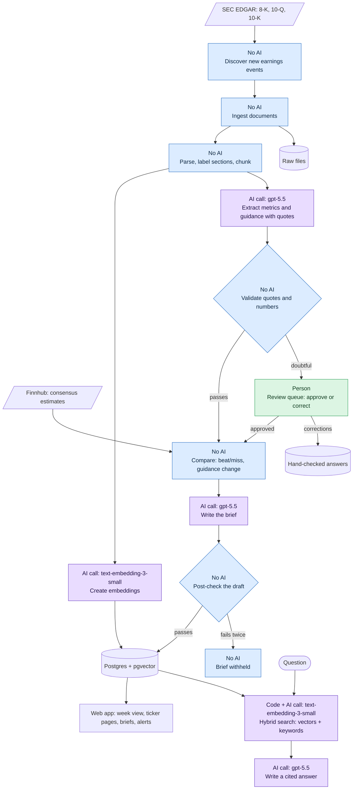

# Project overview

This page explains what the Earnings Intelligence Agent does, who it is for, and how it uses AI. For setup and commands, see the [README](../README.md).

## What it is
The Earnings Intelligence Agent reads a company's quarterly earnings documents and reports what changed, with a source quote behind every claim.

Its core rule is **"The model proposes, the system disposes."** AI reads the documents and writes the text. Ordinary code checks that work and makes every consequential call, such as a beat/miss verdict or a guidance change label.

## The problem
Each earnings report means hundreds of pages per company, but what matters is the change: against consensus, against last quarter, and against the guidance management gave three months ago.

Reading for that by hand takes hours per report, even for ten tickers, and mistakes are easy to make:
- A number is copied from the wrong period.
- Guidance language is paraphrased loosely.
- A reiteration is read as a raise.

## Who it is for
The design names one user, the **operator**: a single person following a watchlist. The operator manages tickers, reads briefs and alerts, corrects extractions in the review queue, and asks questions about the documents.

The design doesn't name job titles, but the app suits anyone covering a small set of US companies, such as an equity analyst, an individual investor, or a finance researcher. It runs locally and has no user accounts.

## Scope

### In scope
- Watching a list of up to 10 tickers and detecting new earnings events.
- Ingesting 8-K press releases and 10-Q/10-K filings from SEC EDGAR.
- Extracting revenue, EPS, margins, segment figures and forward guidance, each with a supporting quote.
- Computing beat/miss against consensus, and labelling guidance as raised, lowered, maintained, new or withdrawn.
- Publishing a one-page cited brief for each report.
- A web app with a week view, ticker pages, alerts, a review queue and a costs page.
- Answering questions from the stored documents, with citations.
- Scoring extraction quality against a hand-checked set of answers.

### Out of scope
- Trading signals, price predictions, and buy/sell recommendations.
- Real-time or intraday processing.
- Non-US filings, non-English sources, and audio transcription.
- Multiple user accounts and permissions.

## Goals

| Goal | How it is measured |
|---|---|
| Correctness over coverage | At least 95% of extracted metrics match the source. A missing metric is acceptable; a wrong one is not. |
| Every claim cited | Every metric and brief statement carries a quote, a document and a location. |
| No false guidance changes | The false "raised" or "lowered" rate on the hand-checked set must be 0. |
| Cheap at small scale | A few dollars per earnings season at 10 tickers, with cost per report logged. |
| Rerunnable and auditable | Any brief can be regenerated from stored sources, and every stage is logged. |

## How it works
The diagram shows how data moves through the system. Each step says who does the work:

| Label | Colour | Meaning |
|---|---|---|
| **AI call** | Purple | Calls an OpenAI model; the label names the model |
| **Code + AI call** | Purple | Plain code that also makes one AI call |
| **No AI** | Blue | Plain code, with no model involved |
| **Person** | Green | The operator decides |

The steps in order:

1. **Discover:** finds new earnings events for the watchlist.
2. **Ingest:** downloads the documents from EDGAR and stores the originals.
3. **Parse:** cleans the text, labels sections, splits it into chunks and creates embeddings.
4. **Extract:** the model returns metrics and guidance with quotes.
5. **Validate:** code checks every quote and number. Anything doubtful goes to the review queue.
6. **Compare:** code computes beat/miss and guidance changes.
7. **Brief:** the model writes from the approved facts, and code checks the draft before it is published.

## AI components

| Component | Tool | What the AI does | What checks it |
|---|---|---|---|
| Extraction | OpenAI `gpt-5.5`, Responses API with structured output | Reads filings and returns metrics and guidance with quotes | Code confirms each quote is in the document word for word and contains the number. Doubtful items go to review. |
| Brief writing | OpenAI `gpt-5.5` | Turns approved facts into a short brief | A post-check requires every figure to be cited and bans recommendation language. A failed draft gets one retry, then the brief is withheld. |
| Embeddings | OpenAI `text-embedding-3-small`, stored in pgvector | Turns document chunks into vectors for search | Combined with keyword search, so results don't rely on vectors alone. |
| Ask (retrieval-augmented answers) | Hybrid search plus OpenAI `gpt-5.5` | Answers questions from retrieved chunks, with citations | Refuses when it finds nothing relevant. |

### Supporting AI engineering
- **Eval harness:** `pnpm eval` runs the real pipeline against hand-checked answers. A gate fails on a false guidance change or a drop in accuracy.
- **Versioned prompts:** prompts are stored as files such as `extract.v2.md`, and a change must pass the eval.
- **LLM gateway:** one layer handles every model call, logging tokens and cost, and pacing requests to stay within rate limits.
- **Human review:** corrections are never overwritten by a later run, and they feed back into the hand-checked answers.

### What AI does not do
These are plain code, so the results are repeatable and auditable:
- Beat/miss verdicts and guidance change labels.
- Fiscal period logic and section labelling.
- Number formatting and quote checking.

## Technology
- **Language and runtime:** TypeScript on Node 24, in a pnpm monorepo.
- **API and jobs:** Fastify, with pg-boss for background jobs.
- **Data:** Postgres 17 with pgvector, accessed through Drizzle.
- **Web app:** Next.js and Tailwind.
- **Testing:** Vitest.

## Current state (November 2026)
- **Working:** the full flow has run on a real report, Vistra (VST) Q2 2026. On two hand-checked cases, the eval showed 100% extraction accuracy, 100% citation precision and no false guidance changes.
- **Not yet run:** the full 7-case eval.
- **Switched off:** call transcripts, so Ask only covers filings and press releases.
- **Needs a provider key:** consensus data. Without a Finnhub key, briefs show no beat/miss verdicts.
- **Weak:** Ask finds the right passage in its top 5 results only 33% of the time, against a 90% target. The web app has no Ask page yet, so Ask is available through the API only.
